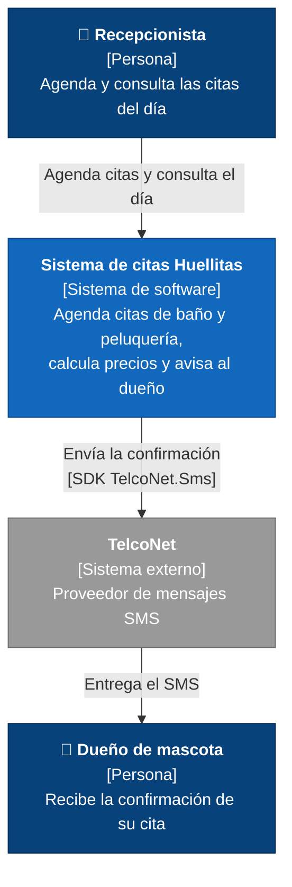
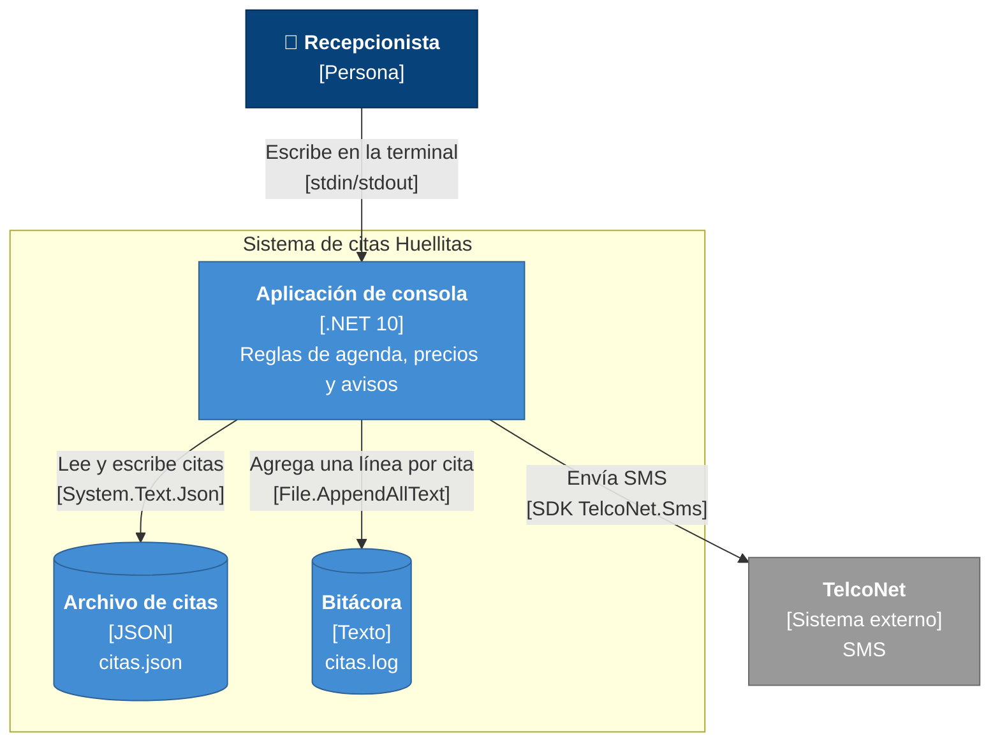
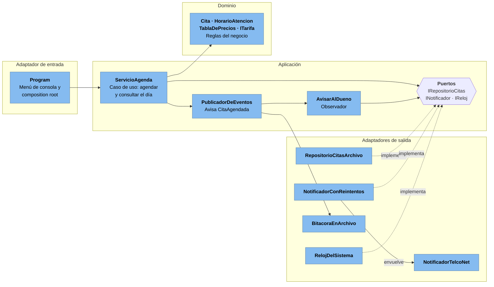
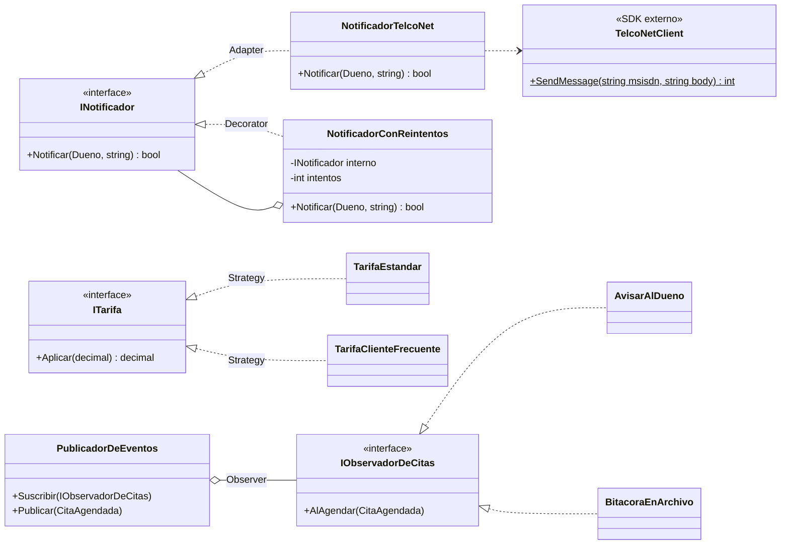

# Citas Huellitas

Agenda de citas de baño y peluquería para la tienda de mascotas Huellitas.
La recepcionista agenda desde la consola, el sistema valida horario y traslapes, calcula el precio,
guarda la cita y le avisa al dueño por SMS.

El repositorio contiene las dos versiones del mismo sistema:

| | Antes | Después |
|---|---|---|
| Proyecto | `src/Huellitas.Citas.Antes` | `src/Huellitas.Citas.{Dominio, Aplicacion, Infraestructura, Consola}` |
| Estructura | Un solo `Program.cs`: consola, reglas, archivo y SMS mezclados | Arquitectura hexagonal (puertos y adaptadores) |
| Probar una regla | Hay que simular la consola y escribir en disco | El dominio y el caso de uso se prueban sin disco, sin consola y sin SMS |
| Cambiar el archivo por una base de datos | Reescribir `Main` | Un adaptador nuevo de `IRepositorioCitas` |
| Cambiar de proveedor de SMS | Buscar cada llamada a `TelcoNetClient` | Un adaptador nuevo de `INotificador` |

## Cómo correrlo

```bash
dotnet test
```

Las dos versiones con el mismo guion de entrada (PowerShell):

```bash
Get-Content entrada-demo.txt | dotnet run --project src/Huellitas.Citas.Antes
```

```bash
Get-Content entrada-demo.txt | dotnet run --project src/Huellitas.Citas.Consola
```

Las dos responden exactamente lo mismo; `EquivalenciaTests` lo verifica en cada build.

---

## Modelo C4

### Nivel 1 · Contexto



### Nivel 2 · Contenedores



### Nivel 3 · Componentes de la aplicación de consola



Las flechas de los adaptadores apuntan **hacia** los puertos: la infraestructura depende de la
aplicación, nunca al revés. `ReglasDeDependenciaTests` lo verifica.

### Nivel 4 · Código: los patrones GoF



---

## Patrones aplicados

| Patrón | Problema que resuelve aquí | Dónde |
|---|---|---|
| **Repository** | El caso de uso pide "las citas del día" sin saber si vienen de un JSON o de una base de datos | `Aplicacion/Puertos/IRepositorioCitas.cs`, `Infraestructura/Persistencia/` |
| **Adapter** | El SDK de TelcoNet pide un número `50499990001` y responde con códigos `int`; la aplicación habla de `Dueno` y `bool` | `Infraestructura/Notificaciones/NotificadorTelcoNet.cs` |
| **Decorator** | Reintentar el SMS si falla, sin tocar el adaptador ni el caso de uso | `Infraestructura/Notificaciones/NotificadorConReintentos.cs` |
| **Strategy** | El descuento de cliente frecuente era un `if` dentro del cálculo; ahora cada tarifa es intercambiable | `Dominio/Precios/Tarifas.cs` |
| **Observer** | Agendar no debería saber cuántas cosas pasan después (SMS, bitácora, lo que venga) | `Aplicacion/Eventos/` |

## Decisiones de arquitectura y su costo

| Decisión | Qué ganamos | Qué pagamos |
|---|---|---|
| **Hexagonal en vez de capas clásicas** | En capas, la aplicación dependía de la capa de datos (ver commit `refactor(capas)`). Ahora el dominio y el caso de uso no conocen ni el archivo ni TelcoNet: se prueban en milisegundos y cada tecnología se cambia con un adaptador | Seis proyectos en lugar de uno y más archivos que leer. Para un CRUD sin reglas no valdría la pena |
| **Una sola aplicación (monolito) y no microservicios** | Un proceso, un despliegue, sin red entre piezas. Hay una sola recepcionista | Si la tienda crece a varias sucursales habrá que separar; los puertos ya marcan dónde cortar |
| **Archivo JSON y no base de datos** | Cero instalación y fácil de revisar | Lee el archivo completo en cada consulta y no soporta varios usuarios a la vez. El Repository deja la decisión aislada |
| **Repositorio con métodos del negocio, no genérico** | `DelDia` y `ContarDelTelefono` dicen lo que el caso de uso necesita | Cada consulta nueva es un método nuevo en el puerto y en sus adaptadores |
| **`Notificar` devuelve `bool` en vez de lanzar excepción** | Si el SMS falla, la cita ya agendada no se pierde | Hoy un fallo definitivo del SMS no se le muestra a la recepcionista |
| **Sin Singleton** | `Program.cs` crea una sola instancia de cada pieza y la inyecta; no hay estado global que complique las pruebas | Hay que pasar las dependencias por constructor |
| **`ServicioAgenda` sin interfaz propia** | Hay un solo adaptador de entrada (la consola); una interfaz más no aporta nada todavía | Si aparece una API web, se evaluará agregarla |

## Historia del repositorio

| Rama | Qué cambia |
|---|---|
| `test/caracterizacion` | Pruebas que registran cómo responde la versión original |
| `refactor/capas` | Dominio aparte y separación en presentación, aplicación y datos |
| `refactor/hexagonal` | Puertos en la aplicación, adaptadores en infraestructura, reglas de dependencia |
| `feature/patrones-gof` | Strategy, Decorator y Observer, un commit cada uno |
| `docs/arquitectura` | Este README con el modelo C4 y las decisiones |
